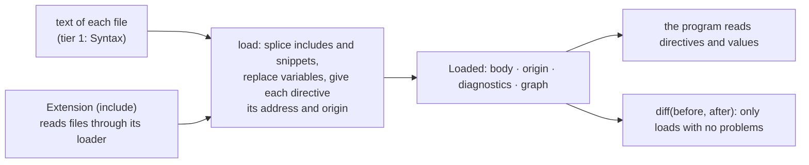

# Knobly: the low-level API, tried by four real programs (round 11 design, revised)

**Status:** architect draft for the gate (kno-9vn), revised after the integrations · **Layer:** **[ System design ]** › Module › Feature · R15 tiers 1-2 only (the sugar is deferred, kno-xlo)

**What the owner is asked:** does this read like an API rasl could really use? Three questions: who names a directive across reloads (§4), whether Python's `load` is synchronous (§5), and whether the DirectiveDelegator still ships (§6). The owner's page is `page-code.md`: it opens with rasl's code, copied from the checked files.

He said on 2026-10-28: "it's not clear how practical these APIs are for a real integration." Four programs were written against the stubs: rasl in TypeScript (`integrate-rasl-ts`) and in Python (`integrate-rasl-py`), a third party's proxy with zod and pydantic (`integrate-third-party`), and the round-10 sugar rebuilt on top (`sugar-on-top-ts`, `sugar-on-top-py`). All pass their type checkers. None has run on knobly, because no v10 parser exists yet (§8).

**Since the first draft:** six changes, each from what the programs ran into (§2). Two pieces were deleted (`whole`, `replaced`). Three were added (`Loaded.origin` and `Loaded.error()`, `collect`/`collecting`, the E6xxx band). One rule was stated (quoting means text), and `diff` now refuses a load with problems. The bead outline does not move materially: one unit gets smaller (diff) and one gets two small helpers (diagnostics).

---

## 1. The config: rasl's real file, in the v10 grammar

Both of rasl's files read as valid v10 text (read against the grammar, not parsed: §8), with no line forced to change. The integrators' copies use the new features only where the real file repeats itself. `configs/family_room.v10.conf` is an excerpt; the comments are new.

```nginx
set $pixels 2284;                     # was written twice: max_count and repeat_until

snippet twinkle $source {             # the six-line twinkle block was written out twice
    seed 11337;
    mode brightness;
    frequency_hz 0.3;
    connect $source;
}

graph {
    node Color hsl_rgb rgb { connect hsl { repeat 30; } }
    node TwinkleEffect twinkle       { use twinkle rgb_150; }
    node TwinkleEffect white_twinkle { use twinkle white_150; }
    node DdpSink leds {
        max_count $pixels;
        connect crossfade_rgb pixels { repeat_until $pixels; }
    }
}
```

`hyperhdr.conf` adds `set $pixels 2284` and `snippet byte_console $source`, used as `use byte_console hyperhdr_color[144:152];`, so a variable's value can be a slice.

| Difference from what rasl reads today | In these two files | Effect |
|---|---|---|
| `20 hz` (two words) was joined into `20hz` (rasl.ts) | both write `20hz` | none |
| Python read `on/yes/off/no` as true/false (loader.py) | only `true` is written | none; only `true`/`false` are booleans |
| `x[3]` was re-read as `x[3:4]` (connect_parser.py) | not written | it becomes the index kind (R5); both readers keep `[3:4]` |
| Includes were ignored (rasl.ts:284) | none written | an include is spliced in where it is written |

---

## 2. What the four programs found, and what changed

| Found by | Friction | Disposition |
|---|---|---|
| rasl TS, rasl Py, third party (F1) | A problem with no line, such as a missing `graph` or `listen`, had nowhere to go. All three built a place at 0:0 by hand | **Model fix:** the root file owns the top level, as a directive owns its block. `Loaded` gets `origin` and `error()` |
| rasl and sugar, both languages | No one passed `whole`, and no one needed `replaced`. rasl tells retune from restart from rewire; both sugars work out their own "replaced" from `restart=True` | **Deleted.** A change says what differs, never what to do. The first draft's claim that rasl uses `whole` was wrong |
| rasl TS, rasl Py, both sugars | A line left out for a syntax error compares as "removed" (rasl-py: "Applying it would strip a property from a running node"). Each of them refused to compare a load with problems | **Contract:** `diff` refuses a load with diagnostics (TypeError / ValueError) |
| rasl TS, rasl Py | Each wrote the same "record it and keep going" helper. Python's has to be a class whose `__exit__` returns bool, so the checkers know the block can stop early | **Added:** `collect(into, read)` in TS and `vl.collecting(into)` in Python, named as `contextlib.suppress` is |
| rasl Py, third party (F4) | What `plain()` makes of a quoted `"8080"` was unstated, so both special-cased quotes | **Rule stated:** quoting means text; only a bare word is a number or true/false (TOML, HCL and both of rasl's readers do the same: loader.py tries numbers before it strips quotes) |
| sugar; third party (F2) | The code table gave the sugar no band. Python never checked a hand-made code | **Stated:** E6xxx is the sugar's, and it makes its Diagnostics directly. Python's `Diagnostic` checks the code form when it is made |
| third party (F3) | In TS, no tag tells a `Loaded` from a `Directive` | **Refuted:** `"name" in target` is narrowing that tsc checks, and F1's fix removed the only other branch |
| third party (F5) | A block's own values have no names (`$args[0]`) | **Refuted:** naming positions is a declaration's job (the sugar's, or the schema's). This layer gives values in order, as PostCSS `params` and `ast` `args` do |
| both sugars | The key rule sees the parent directive, not the sugar's scope, so the sugar works the scope out again | **Kept:** scopes are tier 3's idea. The cost is one cached walk up the parents (20 lines in TS, 35 in Py) |
| both sugars | Changes come at their own address and an added subtree is listed once; inherited reads and refused changes are the sugar's to track | **Kept:** records, inheritance (R29) and `applied(failures)` are sugar concepts; `parent` and `walk` carry them |
| sugar TS | The program reads the root file, and the include loader reads the rest | **Kept:** core does no I/O (R16). rasl hands the same reader to both |
| sugar TS | Handed variables take one text, not `string[]` | **Kept:** the text is read the way the file is, so `--set` and the file never disagree |
| sugar TS | Round 10's include `maxDepth` knob has nowhere to go | **Kept:** limits are knobly's and shared with `use`. He never asked for a knob (numbers are parked) |

The third party's extension (pydantic or zod: a directive into data, each schema error placed back on its value) took 110 lines in Python and 102 in TypeScript. That is evidence the native API is one an extension can wrap (R23, R25).

---

## 3. Prior art: one model per language

| | **TypeScript: PostCSS** | **Python: the standard `ast` module** |
|---|---|---|
| Why this one | A config-shaped language whose plugins do our three features: postcss-import, postcss-mixins (`@define-mixin name $arg`), postcss-simple-vars | The tree Python developers already read: nodes with `__match_args__`, read by `match`, carrying positions |
| Made once, then used | `knobly({ extensions, key })`, as `postcss([plugins])` | none: `vl.load(...)` is a function, as `ast.parse` |
| Walking | `loaded.walk(cb)`, as `root.walk` | `vl.walk(node)`, as `ast.walk` (in written order) |
| Located error | `d.error(msg, code)`, `loaded.error(...)`, as `node.error()` / `root.error()` | `raise d.error(...)`, as a located SyntaxError |
| Keep going | `collect(errors, fn)` | `with vl.collecting(errors):`, as `contextlib.suppress` |
| Our departures | read-only (editing is kno-uji); 0-based lines (R14) | problems are collected (R6); 0-based lines; readers are methods |

**Identity** follows React's list `key`: the program names its children so identity survives reordering. **Change lists** follow the DOM's MutationRecord, which lists an added subtree once by its root. Also weighed: crossplane (no traces, no expansion), HCL (a range on every value, which `Origin` copies), Caddy's dispenser (turned down in round 8), tree-sitter/lezer/libcst (tier-1 tools).

---

## 4. The concepts and their interfaces



| Concept | Owns | Not its job |
|---|---|---|
| Syntax (tier 1) | one file's tokens, lossless tree, syntax problems | includes, variables, meaning |
| load | expansion (`set`, `$x`, `snippet`/`use`, extension directives), limits, addresses, origins | reading files (extensions do), meaning |
| Loaded | the expanded top level, owned by the root file; the file graph; every problem | what the program does with it |
| Directive, Arg | what was written, after expansion; reading a value by the grammar's rules | which directives are allowed where (the sugar's) |
| Origin | where text was written and how it got here | identity |
| Address | identity of a directive across loads | where the text is |
| diff | what differs between two clean loads | what to do about it (retune, restart: the program's) |
| Extension | turning one directive into files to splice in | expansion order, scopes, limits |

### TypeScript (`api-ts/index.d.ts`; tier-1, span and graph types left out)

```ts
interface Loaded {
  readonly body: readonly Directive[];
  readonly origin: Origin;                          // the root file, first position
  readonly diagnostics: readonly Diagnostic[];
  readonly graph: DocumentGraph;
  walk(callback: (directive: Directive) => false | void): void;
  error(message: string, code: ProgramCode): DiagnosticError; // a whole-file problem
}

interface Directive {
  readonly name: string;
  readonly args: readonly Arg[];
  readonly body: readonly Directive[] | undefined;  // undefined: written without a block
  readonly parent: Directive | undefined;
  readonly address: Address;
  readonly origin: Origin;
  readonly node: Node;                              // its tier-1 node, for editing (kno-uji)
  walk(callback: (directive: Directive) => false | void): void;
  error(message: string, code: ProgramCode): DiagnosticError;
}

interface Arg {
  readonly kind: "word" | "string" | "list" | "slice" | "index";
  readonly text: string;                            // as written; equal text means the same value
  readonly origin: Origin;
  word(): string;                                   // each reader throws a located 4xxx error
  string(): string;
  number(): number;                                 // JSON number: 8080, 0.5; not 20hz
  integer(): number;
  boolean(): boolean;
  items(): readonly Arg[];
  slice(): SliceValue | IndexValue;
  plain(): PlainValue;                              // quoted: text; a word: number, boolean, else text
  error(message: string, code: ProgramCode): DiagnosticError;
}

type DiagnosticCode = `E${number}`;                 // 1-5xxx knobly's, 6xxx the sugar's
type ProgramCode = `${string}/${string}`;           // "rasl/unknown-node"

type Change = Added | Removed | Changed;            // Changed: its own values differ, by text

interface Processor {
  load(document: Document, options?: { variables?: Readonly<Record<string, string>> }): Promise<Loaded>;
  diff(before: Loaded, after: Loaded): readonly Change[]; // TypeError if either has diagnostics
}

declare function collect(into: Diagnostic[], read: () => void): void;
```

### Python (`api-py/knobly/__init__.pyi`; same concepts, Python spelling)

```python
@final
class Loaded:
    body: tuple[Directive, ...]              # read-only properties in the stub
    origin: Origin                           # the root file, first position
    diagnostics: tuple[Diagnostic, ...]
    graph: DocumentGraph
    def error(self, message: str, *, code: str) -> DiagnosticError: ...

class collecting:                            # with vl.collecting(errors): ...
    def __init__(self, into: list[Diagnostic], /) -> None: ...
    def __exit__(self, kind, error, trace, /) -> bool: ...  # True for a DiagnosticError only

def load(document: Document, *, extensions: Sequence[Extension] = (),
         variables: Mapping[str, str] | None = None, key: KeyRule | None = None) -> Loaded: ...
def diff(before: Loaded, after: Loaded) -> list[Change]: ...  # ValueError if either has diagnostics
Change: TypeAlias = Added | Removed | Changed
```

`Directive` (`__match_args__ = ("name", "args", "body")`) and `Arg` (`as_word`, `as_str`, `as_number`, `as_int`, `as_bool`, `as_list`, `as_slice`, `plain`, `error`) are unchanged.

### Identity: the address

An **address** is where a directive lands in the expanded tree: one step per level, each step a name, a key and an occurrence (`graph › node leds › max_count`). A snippet used twice, or a file included at two places, gives two addresses (R21: "Allowed, per place"). The key comes from the program's **key rule**.

**Question: who names a directive among its siblings, so it keeps its identity when lines move?**

| | **A. The program gives a key rule (recommended, shown)** | B. knobly's fixed rule: a directive with a block is named by its values | C. Position only |
|---|---|---|---|
| Evidence | rasl and both sugars wrote one; rasl TS names nodes by id, connects by what they connect, fills by port | would not name rasl's connects or fills | |
| Cost | every program writes a rule until the sugar exists | changing a node's type is "removed + added"; a line with no block is named by position | inserting one node marks every later node changed |

---

## 5. Change lists, includes, traceability, diagnostics

| Change | When (compared by address) | Listed inside it? |
|---|---|---|
| `added` / `removed` | the address is in one load only | no: one change for the subtree (`walk` it) |
| `changed` | same address; its own values differ, by text after expansion | yes: changes in its block are listed at their own addresses |

Editing `set $pixels 2284` to `2400` lists `changed` at `graph › node leds › max_count` and at `… › connect crossfade_rgb pixels › repeat_until`, and never the `set` line. rasl's `planReload` turns that into a retune and a rewire of `leds`.

**Includes** are a graph of files (`loaded.graph`: each file parsed once, R21), while in the walk the included directives stand where the `include` line was. Each one's `origin` and `node` point into its own file, so an edit can land there (R8). Include is an `Extension` made with its loader (R20). Depth, cycles and per-place variables are knobly's, shared with `use`. rasl-py watches `loaded.graph.nodes` for file-change events.

**Traceability.** `origin.written` is where the text is, and `via` lists the steps (variable, use, extension) that brought it here, innermost first. The third party's probe (real zod and pydantic, a stand-in knobly) placed `rate` at `fast` in `use limits fast;`, via `$rps` at 5:10, via `use limits` at 12:5.

**Diagnostics** carry a code, a message and an origin. `load` collects them all and never throws for the text; a reader throws one located error; `collect` keeps going. A whole-file problem is `loaded.error(...)`. `formatDiagnostic` prints `file:line:col: code: message`, the source line, a caret and one `via` line per step (rasl-ynq).

**Question: is Python's `load` synchronous?**

| | **A. Synchronous (recommended, shown)** | B. Async only, as TypeScript | C. Both, `load` and `aload` |
|---|---|---|---|
| Evidence | all three Python programs call it from plain functions | | |
| Cost | an asyncio program that reads includes over a network blocks its loop, or uses a thread | every script and test needs an event loop | two entry points and two loader types for one question |

---

## 6. Design rules (design choices, not requirements)

1. **Expanded for the reader, never lost.** A program sees only expanded directives. Every directive and value carries its origin, and tier 1 keeps the text as written.
2. **Identity is where a directive lands; origin is where it was written.** A change list compares the addresses of two loads that have no problems. It says what differs and never what to do.
3. **Located, or not a problem.** Every diagnostic has an origin, and a whole-file problem is placed at the root file. `load` never throws for the text, and a reader throws only a located error.

**The round-10 sugar is built only on this layer** (both rebuilt and type-checked this round):

| The sugar needs | This layer gives |
|---|---|
| directives matched to declarations, values typed | `Directive`, `Arg` readers (value types' `parse` takes `Arg`) |
| inheriting from the nearest block | `parent` |
| `key=True` / `@Key` | the key rule |
| `restart=True`, a changed node type, `changes.of(D)`, `@OnChange`, `applied(failures)` | `diff` by `address`, plus `parent` and `walk`; the sugar keeps the last applied load and works out "replaced" |
| `ConfigError(at=...)`, its own codes; the include module | `arg.error()`, `Origin`, E6xxx; `Extension` |

**Question: does the DirectiveDelegator (kno-stq) still ship?**

| | **A. No: its job is split (recommended)** | B. Ship a dispatch-by-name walker in this layer |
|---|---|---|
| Evidence | rasl and the third party read with `if` or `match`; the sugar does its own per-directive calls on top of the walk | |
| Cost | kno-stq's acceptance text (hooks, typed `children/skip` results) is not met as written; kno-stq closes into kno-xlo | a third way to read a config; in Python it is subclass-based, the style he called "too class-inheritance driven" |

---

## 7. Costs, deferred, and what happens next

**Costs**
- **Programs map changes to their own units.** rasl lifts each change to its node (`reload.ts` lines 14-32; `_mark` in `reload.py`, about 20 lines). There is no `whole` to do it for them.
- **A broken edit shows no change list.** `diff` refuses it. The program keeps the last good load and reports the errors, as rasl and both sugars already did.
- **Python's `load` blocks while files are read** (§5).
- **A value's text is its identity for "changed"**, so `0.5` → `0.50` is listed. Both sugars skip equal values themselves.
- **Scope:** a new token, an expansion pass, addresses and diff, readers (lists are unread today), and a Python include graph that does not exist (C7). All in both languages, with spec/ pages.

**Deferred:** the sugar (kno-xlo), editing (kno-uji), severity and warnings, variables inside words (`join: whole`), conditionals and loops.

**Tracer bullet:** rasl loads `family_room.conf` and `hyperhdr.conf` through `load` in TypeScript and Python. Both print the same node list, the same diagnostics for `integrate-rasl-ts/planted/family_room.bad.conf` (its header lists them), and the same plan after an edit to `set $pixels`. That proves expansion, origins, addresses and diff with identical codes and spans (R17). Non-goals: the sugar, editing, globs, speed.

**Bead outline (logical units):** grammar and lexers (`$name`) · expansion (variables, snippets, extension splicing, limits) · values and readers · address and diff · include extension (both languages; Python's graph is new) · diagnostics, `collect`, formatting · spec/ pages and test cases · rasl tracer.

---

## 8. Evidence and NOT RUN

All seen this round (pinned versions as round 10: tsc 6.0.3 on Node 24.14.1; pyright 1.1.407 strict and mypy 1.18.2 --strict on Python 3.11):
- `round11/run.sh` (stubs and their rasl examples): tsc exit 0, and 6 of 6 planted mistakes exit 2. pyright and mypy exit 0, and 6 of 6 planted mistakes fail in both.
- `integrate-rasl-ts/run.sh`: tsc exit 0. `integrate-rasl-py/run.sh`: pyright 0 errors (2 expected stub-only warnings), mypy exit 0.
- `integrate-third-party/run.sh`: tsc, pyright and mypy exit 0. Both probes exit 0.
- `sugar-on-top-ts/run.sh`: tsc exit 0, and 5 planted mistakes exit 2. `sugar-on-top-py/run.sh`: pyright and mypy exit 0, and its one run against `fake-core` exits 0.

Integration code changed only to keep compiling after the deletion: rasl-py `reload.py`, sugar-py `_changes.py` and `fake-core`, and sugar-ts `app.ts` (one line each).

**NOT RUN:** no v10 parser exists, so no config was loaded and rasl's readers and reloads never ran. The probes and the Python sugar run used hand-built stand-ins. The TS sugar never ran. "Valid v10 text" was judged by reading. Also not run: a review of this revision (the round's `review.md` was not on disk), ruff, eslint, and other versions.

### Reconcile with existing code (and the cost)

| Today (knobly `ts/`, `py/`) | This design | Cost |
|---|---|---|
| `IAstDocument`/`IAstDirective`: one file, unexpanded, identity by object (`ast.ts`) | `Loaded`/`Directive`: expanded, with address and origin | replaces the facade and rewrites its tests; dropping the `IAst` names needs the owner's OK |
| `parseGraph`, include built into `parse-graph.ts` and `iterate.ts`, E2006 a syntax code | `load` plus the include `Extension`; the graph keeps its names (`DocumentGraph`, `DocumentNode`, `DocumentEdge`, `resolvedPath`) | include moves out of core (R20); E2006 becomes an extension code |
| `IGraphDiagnostic` (path only); no chain | `Diagnostic` with `Origin`; `Loaded.error` | every place that makes a diagnostic changes |
| `valueOf`, list throws (`value.ts:74`) | `Arg` readers; lists read; quoted values are text | list reading is built; `SliceValue`/`IndexValue` lose `span` |

**For the code architects (parked):** address text escaping · depth and size limit numbers · diff cost on large trees · origin storage · how Python checks that two loads share a key rule · the 4xxx/5xxx/6xxx numbers · the include loader losing `depth` · whether `Origin` for a directive can be typed `written: Place` (never `Handed`; rasl-py's `_where` handles a case that cannot occur).

### New terms

| Term | Meaning | Why needed | Could be an existing term |
|---|---|---|---|
| loaded | what one load produced: expanded top level (owned by the root file), problems, file graph | the one result a program reads | round 8's "expanded tree" |
| origin | where text was written (`written`) and the steps that brought it here (`via`) | traceability (use site and definition) | R14's "include chain", widened |
| step | one expansion: a variable, a use, or an extension directive | the parts of `via` | round 10's `via` |
| handed | a variable value the program passed in, written in no file | `$host` from `rasl --set host=…` | round 10's "handed in" |
| address | where a directive lands, one step per level: name, key, occurrence | identity for change lists | v15's "identity" |
| key rule | the program's rule naming a directive among its siblings | stable addresses when lines move | the sugar's `key=True` |
| extension | owns one directive name and gives files to splice in its place | include as a first-party plugin (R20) | round 10's "plugin" |
| plain value | a value read by knobly's one rule: number, true/false, text, slice, list | rasl's open property sets | R7's "knobly's one rule" |

*History: v10 approved the language · round 11: the low-level API · revised after four integrations (whole and replaced deleted; whole-file errors, collect, quoted-means-text).*
