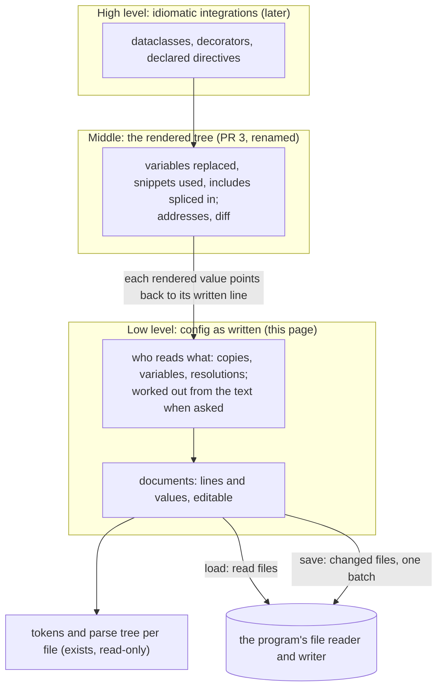

# Knobly: the low level, config as written (round 12)

**Status:** draft for your review · **Layer:** **[ System design ]** of the low-level layer › Module › Feature

**What you are asked:** is this the shape of "config as written", the layer under the rendered tree? Three
questions sit under the sections they concern: what an edit to a shared line does (§3), how a program writes new
values (§5), and the names `load` and `render` (§2).

---

## 1. Since your answers of 2026-10-28

| You said (2026-10-28) | What this round does |
|---|---|
| "you have incorrectly written the middle layer representation as if it were the low-level API. lets start there." | PR 3's tree becomes the middle layer, renamed the **rendered tree**. A new low level sits under it: the files as written |
| "consumers need to be able to see which files were included in a config load, what variables exist, and where they were overloaded" | §3 (1): every file read and the include line that pulled it in; every variable, where each use reads it, and what wins over it |
| "consumers should be able to manipulate/alter that data so that it can be written back to the source files" | §3 (2)-(5): edits on the written lines, in any file, saved back with comments and layout kept |
| "It depends if the integration program changes the `$pixels` variable itself, or if it instead changes `max_count` to no longer use the variable. both kinds of changes should be possible" | §3 (2) and (3): both, one call each |
| "a rendered config tree is not something that we currently have. that seems like a medium layer between the low-level API (AST level?) and the high-level (idiomatic integrations)." | §2's picture: three layers. The rendered tree reads the low level and points back into it |

Still standing: your 2026-10-24 question "How will includes be round-tripped through modifications to an included
subtree?" is answered in §3 (4). One `set` per name per block stays, as you agreed.

---

## 2. The three layers

The **low level** holds each file as written and lets a program edit it. The **middle** (PR 3's tree, renamed)
is built from it on request and is read-only. The **high level** (the dataclass and NestJS sugar) comes later.



The core still does no file I/O: the program hands in a **file source** (reads files) and a **writer** (writes
them). Both exist today; the writer now takes all changed files in one call.

QUESTION:names

---

## 3. User code first (rasl, `fixtures/rasl/split`)

The fixture: `main.conf` sets `$pixels 2284;` (line 4) and includes `sink.conf` twice, at line 19 (`$name leds`)
and line 24 (`$name porch`). `sink.conf` holds one `node DdpSink $name { ... max_count $pixels; }`.

```ts
import { save, knobly } from "knobly";
import { include } from "knobly/include";
import { createFileSource, createFsWriter } from "knobly/node";

const config = knobly({ source: createFileSource(), extensions: [include()], key: RASL_KEY });

// The low level: the files as written, plus one value the program hands in.
const graph = await config.load("split/main.conf", { variables: { leds_host: '"10.0.70.1"' } });

// The middle layer, built from the current texts. Reads no file.
const rendered = config.render(graph);
```

```python
from knobly import Processor, save          # save: new in Python
from knobly.files import file_source, fs_writer   # fs_writer: new
from knobly.include import include

config = Processor(source=file_source(), extensions=[include()], key=RASL_KEY)
graph = config.load("split/main.conf", variables={"leds_host": '"10.0.70.1"'})
rendered = config.render(graph)
```

### (1) Which files were read, what variables exist, where each is overridden

`line_of`, `trail` and `node_named` below are the program's own small helpers (a place as `file:line`, an include
path as text, a rendered node by name).

```ts
// Every file read, and the include lines that pulled it in.
for (const doc of graph.documents.values())
  console.log(doc.resolvedPath, doc.includedBy().map((edge) => lineOf(edge.copy.statement.place)));

// Every variable: where it is written, where it is read, where something else wins.
for (const variable of graph.variables()) {
  console.log(`$${variable.name}`, variable.kind, variable.place ? lineOf(variable.place) : "handed in");
  for (const r of variable.reaches()) console.log("  used at", lineOf(r.reference.place), "via", trail(r.copy.via));
  for (const r of variable.overridden()) console.log("  overridden at", lineOf(r.reference.place), "by", r.winner);
}
```

```python
for doc in graph.documents.values():
    print(doc.resolved_path, [line_of(edge.copy.statement.place) for edge in doc.included_by()])

for variable in graph.variables():
    print(f"${variable.name}", variable.kind, line_of(variable.place) if variable.place else "handed in")
    for r in variable.reaches():
        print("  used at", line_of(r.reference.place), "via", trail(r.copy.via))
    for r in variable.overridden():
        print("  overridden at", line_of(r.reference.place), "by", r.winner)
```

What it prints for the fixture, as a table:

| Variable | Written | Used at | Overridden |
|---|---|---|---|
| `$pixels` | main.conf:4 | sink.conf:6, once through each include (main.conf:19 and :24) | no |
| `$leds_host` | main.conf:5 | nowhere | at main.conf:21, by the handed-in value |
| `$leds_host` | handed in, `"10.0.70.1"` | main.conf:21, `set $host $leds_host;` | no |
| `$name`, `$host` | main.conf:20-21 (first include's block) | sink.conf:2-3, through the include at :19 | no |
| `$name`, `$host` | main.conf:25-26 (second include's block) | sink.conf:2-3, through the include at :24 | no |

### (2) Change `$pixels` itself, and (3) change `max_count` to no longer use it

A rendered value carries one **resolution** for each `$name` it came through. A resolution says which variable
wins at that place, and points at the `$name` as written.

```ts
const maxCount = nodeNamed(rendered, "leds").body!.find((d) => d.name === "max_count")!.args[0]!;
const read = maxCount.resolutions[0]!;     // `$pixels` as read by the leds sink; winner: `set $pixels 2284;`

// (2) Change the variable itself: main.conf:4 becomes `set $pixels 2400;`. Both sinks read 2400.
read.winner!.setValues("2400");

// (3) Change the line so it no longer uses the variable: sink.conf:6 becomes `max_count 2400;`.
read.reference.replaceWithText("2400");
```

```python
max_count = next(d for d in node_named(rendered, "leds").body if d.name == "max_count").args[0]
read = max_count.resolutions[0]
read.winner.set_values("2400")             # (2)
read.reference.replace_with_text("2400")   # (3)
```

A chain picks its step: `target $host` at the leds sink has `resolutions[0]` for `$host` and `[1]` for
`$leds_host`. Kind (3) edits sink.conf:6, a line both sinks read, so `porch` reads 2400 too. That is question 1.

QUESTION:copies

### (4) Edit a line inside the included file, then undo

This is the answer to "How will includes be round-tripped through modifications to an included subtree?". An edit
always lands in the file the line is written in; the rendered tree only points to it.

```ts
const node = nodeNamed(rendered, "porch").written;   // `node DdpSink $name {` in sink.conf
node.copies().length;                                 // 2: this one line renders both leds and porch

const kept = node.document.text;                      // keep the text to undo later
const [fps] = node.block!.directives("fps");
fps!.setValues("30hz");                               // `fps 20hz;` becomes `fps 30hz;`
node.block!.insertStatements(node.block!.statements.indexOf(fps!) + 1, "brightness 0.8;");

node.document.replaceWithText(kept);                  // undo: sink.conf's text is back; still unsaved elsewhere
```

### (5) Save

```ts
const written = await save(graph, createFsWriter());  // only changed files, handed over in one batch
await save(graph, createFsWriter());                  // []: nothing changed since, nothing written
```

```python
written = save(graph, fs_writer())
```

---

## 4. The domain concepts

| Concept | What it is | Rule it keeps |
|---|---|---|
| **document graph** (exists) | the files one load read, plus the values the program handed in | each file read once; `unread()` names files an edit now needs but no one has read |
| **document** (exists) | one file as written | its current text is the truth; `source` is the text as read or last saved |
| **statement** | one written line: a directive, an include line, `set`, `snippet`, `use`, or a line that does not parse | an edit changes only its own text and the comments it owns |
| **written value** | one value as written: a word, string, list, slice, index or `$name` | its text is exactly what is in the file |
| **copy** | one place a statement is read: at the top of the root file, or through a chain of includes and `use` lines | worked out when asked; sink.conf's lines have two copies |
| **edge** (exists) | one copy of an include line, and the files it matched | a pattern matching several files lists each |
| **variable** | a `set` line's `$name`, a snippet's parameter, or a value handed in | known by where its `$name` is written, or by the handed-in name |
| **reference** | one `$name` written where a value goes | its **declaration** is the variable it belongs to by where it is written |
| **resolution** | at one copy: which variable a reference reads (the **winner**) and which it wins over | worked out when asked, never stored |

Three design rules (choices, not your requirements):

1. **The text is the only source of truth.** Copies, edges, variables and resolutions are worked out from the
   current texts when asked. Nothing is kept "as of the load".
2. **An edit changes only what it names.** A line owns the comments right above it and at its end; the rest of the
   file stays byte for byte. An edit that would leave a syntax error does nothing and throws.
3. **One home for "which `$name` reads which variable".** It moves from PR 3's expansion into this layer; the
   rendered tree reads the answer and never looks a name up itself.

---

## 5. Interface sketches

### TypeScript (modelled on ts-morph: a live tree with named edit methods)

A **handle** is the object a program holds for one written thing. It stays the same object for the graph's life
(`===` holds) and follows its text across other edits.

```ts
// --- The processor: reads files, builds the rendered tree ---
interface IProcessor {
  /** Read the root file and each file its includes name, once. Throws ReadError if the root cannot be read. */
  load(path: string, options?: ILoadOptions): Promise<IDocumentGraph>;

  /** Read the files in `graph.unread()` (for example after an edit added an include). Keeps every text. */
  read(graph: IDocumentGraph): Promise<readonly string[]>;

  /** The middle layer, built from the current texts. Reads no file. */
  render(graph: IDocumentGraph): IRendered;
}

// --- Files ---
interface IDocumentGraph {
  readonly root: IDocument;
  readonly documents: ReadonlyMap<string, IDocument>;   // every file read, root first; never shrinks
  readonly handed: ReadonlyMap<string, string>;          // values the program handed in; never saved

  /** Add, change or (with undefined) remove a handed-in value, without reloading. */
  setHanded(name: string, text: string | undefined): void;

  // Worked out from the current texts each time they are asked for (design rule 1):
  edges(): readonly IDocumentEdge[];
  unread(): readonly IDocumentEdge[];                     // include copies naming files not read yet
  variables(name?: string): readonly IVariable[];
  diagnostics(): readonly IDiagnostic[];                  // located errors, same codes as today
}

interface IDocument {
  readonly resolvedPath: string;
  readonly source: string;                                // as read, or as last handed to the writer
  readonly text: string;                                  // now; differs from `source` exactly when unsaved
  readonly body: IWrittenBlock;

  /** The include copies that pull this file in; empty for the root. */
  includedBy(): readonly IDocumentEdge[];

  /** Replace the whole text (undo, a formatter). Every handle into this file stops working. */
  replaceWithText(text: string): void;
}

/** One copy of an include line, and what it matched. */
interface IDocumentEdge {
  readonly copy: ICopy;                                   // copy.statement is the include line itself
  readonly targets: readonly string[];                    // every file matched, in splice order
}

/** One place a statement is read. */
interface ICopy {
  readonly statement: Statement;
  readonly via: readonly IStep[];                         // the include and `use` steps (existing), innermost first
}

// --- What is written: one kind per line ---
type Statement = IWrittenDirective | ISetLine | ISnippetLine | IUseLine | IUnreadableLine;

interface IStatementBase {
  readonly document: IDocument;
  readonly place: IPlace;                                 // file, line, column (existing)
  readonly text: string;                                  // exact, with the comments it owns

  copies(): readonly ICopy[];                             // every place it is read now
  replaceWithText(text: string): readonly Statement[];    // throws BadTextError if the text does not parse
  remove(): void;                                         // with its comments
}

interface IWrittenDirective extends IStatementBase {
  readonly kind: "directive" | "extension";              // "extension": an include line
  readonly name: string;
  readonly values: readonly WrittenValue[];
  readonly block: IWrittenBlock | undefined;

  rename(name: string): void;
  /** Replace every value, first to last. */
  setValues(text: string): void;
}

interface ISetLine extends IStatementBase {
  readonly kind: "set";
  readonly variable: IVariable;
  readonly values: readonly WrittenValue[];               // after the `$name`
  setValues(text: string): void;
}

interface IWrittenBlock {
  readonly statements: readonly Statement[];
  directives(name?: string): readonly IWrittenDirective[];
  /** New lines, indented like their neighbours. */
  insertStatements(index: number, text: string): readonly Statement[];
  addStatements(text: string): readonly Statement[];
}
// ISnippetLine (name, parameters, block) and IUseLine (snippet, values) follow the same pattern.

// --- Variables ---
interface IReference {                                    // one `$name` written as a value
  readonly kind: "reference";
  readonly name: string;                                  // without the `$`
  readonly declaration: IVariable | undefined;            // by where it is written; undefined when free
  resolutions(): readonly IReferenceResolution[];         // one per copy
  replaceWithText(text: string): readonly WrittenValue[]; // kind (3): stop using the variable here
}

interface IVariable {
  readonly kind: "set" | "parameter" | "handed";
  readonly name: string;
  readonly place: IPlace | undefined;                     // undefined when handed in

  references(): readonly IReference[];                    // every `$name` that belongs to it
  reaches(): readonly IReferenceResolution[];             // copies where it wins
  overridden(): readonly IReferenceResolution[];          // copies where another wins
  rename(name: string): void;
  /** Kind (2): change its `set` line. Throws NoSetLineError for a parameter or a handed-in value. */
  setValues(text: string): void;
}

interface IReferenceResolution {
  readonly copy: ICopy;
  readonly reference: IReference;
  readonly winner: IVariable | undefined;                 // undefined: render reports the error
  readonly overridden: readonly IVariable[];              // what it wins over, nearest first
}

// --- Saving: the core hands text to the program's writer ---
interface IFileWrite {
  readonly resolvedPath: string;
  readonly text: string;                                  // what to write
  readonly source: string;                                // what was read: the writer can spot a file changed on disk
}
interface IDocumentWriter {
  write(files: readonly IFileWrite[]): Promise<void>;     // one batch
}
/** Hands over changed files only. On success each `source` becomes the saved text. */
declare function save(graph: IDocumentGraph, writer: IDocumentWriter): Promise<readonly string[]>;

/** A plain string as knobly text: quote("10.0.60.31") is `"10.0.60.31"`. */
declare function quote(text: string): string;
```

### Python (the same model, written the Python way)

Methods are snake_case and synchronous; fields are read-only properties. A block reads as a `Sequence`, kinds are
classes so `match` can tell them apart, and a handle is the same object each time (`is`).

```python
class Processor:
    def load(self, path: str, *, variables: Mapping[str, str] | None = None) -> DocumentGraph: ...  # ReadError
    def read(self, graph: DocumentGraph, /) -> list[str]: ...
    def render(self, graph: DocumentGraph, /) -> Rendered: ...

class WrittenBlock(Sequence[Statement]):          # iterate, index, len, `in`
    def directives(self, name: str | None = None) -> tuple[WrittenDirective, ...]: ...
    def insert_statements(self, index: int, text: str, /) -> tuple[Statement, ...]: ...
    def add_statements(self, text: str, /) -> tuple[Statement, ...]: ...

class WrittenDirective:
    @property
    def name(self) -> str: ...                    # change it with rename()
    def set_values(self, text: str, /) -> None: ...

Statement = WrittenDirective | SetLine | SnippetLine | UseLine | UnreadableLine
WrittenValue = Word | String | List | Slice | Index | Reference

def save(graph: DocumentGraph, writer: DocumentWriter, /) -> list[str]: ...   # SaveError
def quote(text: str, /) -> str: ...
class EditError(ValueError): ...                  # BadTextError, DetachedError, NoSetLineError
```

QUESTION:values

### How the middle layer points back

| Rendered tree | Points to |
|---|---|
| `render(graph)` | the current texts, copies and resolutions |
| a rendered directive's `written` (replaces today's `node`) | the statement it is a copy of |
| a rendered value's `written` | the written value at the end of its chain; undefined when handed in |
| a rendered value's `resolutions` | one per `$name` it came through, innermost first |

A rendered tree is a snapshot: after an edit, render again. Diff is unchanged.

---

## 6. Costs and deferrals

**What this gives up**

- A rendered tree read after an edit shows the old text until rendered again. Its handles still edit the live files.
- Live handles give up "nothing changes under you" and whole-graph undo. Undo is per file: keep its text, put it back.
- An edit that adds an include leaves the graph incomplete until `read(graph)`; `unread()` says so.
- Kind (3) changes the written line, so every copy of it changes (question 1).
- All-or-nothing on disk is the writer's job; a writer that writes in place can leave half a save.

**What it costs to build**

| Today (PR 3) | This design | Cost |
|---|---|---|
| name lookup inside expansion, both languages | moves into this layer (design rule 3) | large, both languages |
| `load` returns the expanded tree | `load` returns files; `render` the tree (question 3) | every caller and the API doc |
| edges stored at load | worked out from current texts | medium |
| `node` on a rendered directive | `written` and `resolutions` | small; closes kno-uji |
| `save` in TypeScript only, one write per file | one batch, both languages | small |

**Deferred:** creating or deleting files; several root files in one graph; ids a program keeps across processes.
**Not planned:** a whole-file pretty-printer; raw token edits that skip the handles.

The other design considered: immutable trees (Roslyn, LibCST), where each edit returns a new graph. It was set aside
because every edit must pass the new graph along, and held handles go stale.

---

## 7. What happens next

If the shape reads right, one thin build goes end to end in both languages on `fixtures/rasl/split`, with an
in-memory file source and a writer that records what it is handed:

1. `load`, then print §3 (1)'s table.
2. Kind (2) through `resolutions[0]`: `save` hands over only main.conf with `2400`; `render` shows both sinks at 2400.
3. Kind (3) from a fresh load: `save` hands over only sink.conf; `$pixels` reaches nothing.

That proves both halves of name lookup, resolutions on rendered values, edits that keep layout, and save. Not in
it: §3 (4), `read`, the high level, diff.

---

## 8. New terms

| Term | Definition | Why needed | Existing term it could be |
|---|---|---|---|
| rendered tree, `render` | PR 3's tree with variables replaced, snippets used and includes spliced in, and the step that builds it | your word for the middle layer | `ILoaded`, `load` |
| statement | one line as written, editable | the low level's subject | a directive in the rendered tree |
| written value | one value as written, editable | values are edited one by one | a rendered value (argument) |
| copy | one place a statement is read | the same line reads different variables at each include | `IOrigin.via` (exists) |
| reference | one `$name` written where a value goes | "use" is already the snippet line | a variable step (`IStep`) |
| declaration | the variable a reference belongs to by where it is written | renaming, unused snippets | none |
| resolution, winner | at one copy, which variable a reference reads, and what it wins over | your "where they were overloaded" | none |
| handle | the object a program holds for one written thing | edits are calls on it | none |
| handed-in value | a variable value the program gives to `load` | it can win over a `set` | today's load `variables` option |
| file source, writer | the program's objects that read and write files | the core does no I/O | `IDocumentSource`, `IDocumentWriter` (exist) |
