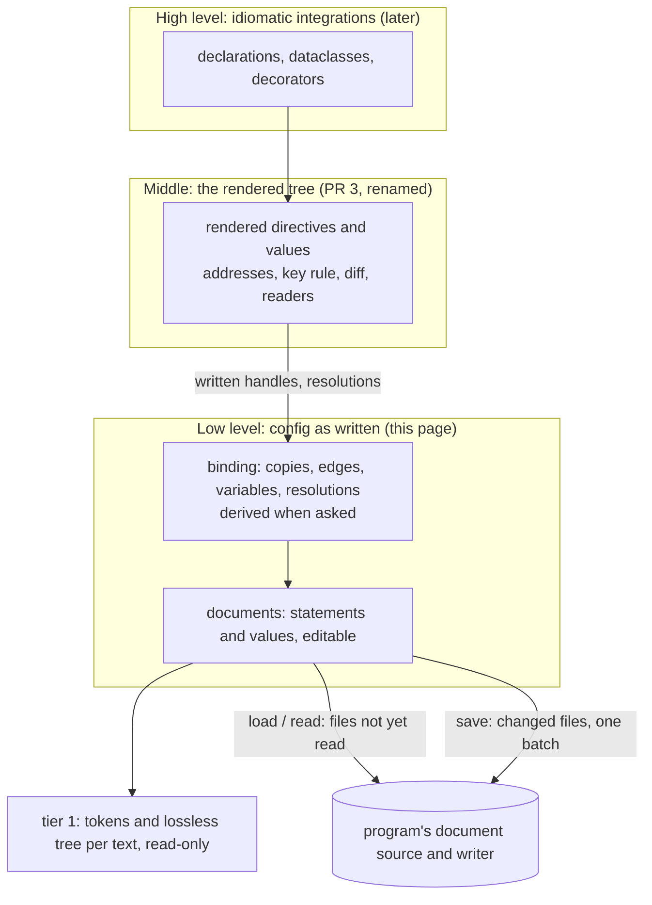

# Round 12: the low-level layer (config as written, editable, saved back)

Layer: **[system design]** · module · feature. Revised draft. Asked: is this the shape of "config as written"
under the rendered tree, plus three questions where they belong.

## 1. User code first (rasl, `fixtures/rasl/split`)

`load` returns the files **as written**; `render` (PR 3's tree, renamed) is a second, pure step.

```ts
import { save, villanelle } from "villanelle";
import { include } from "villanelle/include";
import { createFileSource, createFsWriter } from "villanelle/node";

const config = villanelle({ source: createFileSource(), extensions: [include()], key: RASL_KEY });
const graph = await config.load("split/main.conf", { variables: { leds_host: '"10.0.70.1"' } });
const rendered = config.render(graph);               // the middle layer
```

### (1) Which files were read, what variables exist, where each is overridden

```ts
for (const doc of graph.documents.values())
  console.log(doc.resolvedPath, doc.includedBy().map((edge) => lineOf(edge.copy.statement.place)));

for (const variable of graph.variables()) {
  console.log(`$${variable.name}`, variable.kind, variable.place ? lineOf(variable.place) : "handed in");
  for (const r of variable.reaches()) console.log("  used at", lineOf(r.reference.place), "via", trail(r.copy.via));
  for (const r of variable.overridden()) console.log("  overridden at", lineOf(r.reference.place), "by", r.winner);
}
```

It prints, for the split fixture (lines 1-based; files: main.conf, root; sink.conf at main.conf:19 and :24):

| Variable | Written | Used at (each copy) | Overridden |
|---|---|---|---|
| `$pixels` | main.conf:4 `set` | sink.conf:6, via include main.conf:19; and via :24 | no |
| `$leds_host` | main.conf:5 `set` | none | at main.conf:21, by the handed-in `leds_host` |
| `$leds_host` | handed in `"10.0.70.1"` | main.conf:21 `set $host $leds_host` | no |
| `$name`, `$host` | main.conf:20, :21, include line's block | sink.conf:2, :3, via include main.conf:19 | no |
| `$name`, `$host` | main.conf:25, :26 | sink.conf:2, :3, via include main.conf:24 | no |

### (2) Change `$pixels` itself, and (3) change `max_count` to no longer use it

A rendered value carries one **resolution** per `$name` it came through: what it reads at this copy.

```ts
const maxCount = nodeNamed(rendered, "leds").body!.find((d) => d.name === "max_count")!.args[0]!;
const read = maxCount.resolutions[0]!;   // `$pixels` at the leds copy; winner `set $pixels 2284;`

// (2) the variable itself: main.conf:4 changes, so every use changes (both sinks read 2400)
read.winner!.setValues("2400");          // a chain picks its step: `target $host`'s [0] is `$host`

// (3) the line no longer uses the variable: `max_count $pixels;` becomes `max_count 2400;`
read.reference.replaceWithText("2400");
```

```python
read = next(d for d in node_named(rendered, "leds").body if d.name == "max_count").args[0].resolutions[0]
read.winner.set_values("2400")           # (2)
read.reference.replace_with_text("2400") # (3)
```

**Where L3 holds.** (2) reaches the variable this value reads at its own copy, for any chain; for a parameter it is
`read.values[0]!.replaceWithText(...)` on the `use` line. (3) edits a written line that both copies read, so
`porch` reads 2400 too: kind (3) is met per written line, not per copy (question 1).

### (4) Edit a directive inside the included file, and undo

```ts
const node = nodeNamed(rendered, "porch").written;    // `node DdpSink $name {` in sink.conf
node.copies().length;                                  // 2: it renders `leds` and `porch`
const kept = node.document.text;
const [fps] = node.block!.directives("fps");
fps!.setValues("30hz");                                // `fps 20hz;` becomes `fps 30hz;`
node.block!.insertStatements(node.block!.statements.indexOf(fps!) + 1, "brightness 0.8;");
node.document.replaceWithText(kept);                   // undo: `source` is untouched, earlier edits stay unsaved
```

### (5) Save

```ts
const written = await save(graph, createFsWriter());   // changed files only, in one batch
await save(graph, createFsWriter());                   // []: saving twice writes once
```

> **Question 1. An edit to a line read at several copies changes every copy** (sink.conf's lines: `leds` and
> `porch`; a snippet body: one per `use`).
> - **A (recommended): the edit lands on the written line; every copy sees it**, and `statement.copies()` says how
>   many. Cost: a program that meant "only porch" must notice and write C's edit itself.
> - B: such an edit fails unless the program names the copies it accepts. Cost: a copies argument on every edit
>   method, in both languages.
> - C: villanelle does "this copy only" by writing a `set` into that include line's block and a `$name` into the
>   line. Cost: a refactoring tool (the high level's); impossible inside a snippet body.

## 2. Requirements (his words)

| # | Requirement | Source |
|---|---|---|
| L1 | "consumers need to be able to see which files were included in a config load, what variables exist, and where they were overloaded" | owner, 2026-10-28 |
| L2 | "consumers should be able to manipulate/alter that data so that it can be written back to the source files" | owner, 2026-10-28 |
| L3 | "It depends if the integration program changes the `$pixels` variable itself, or if it instead changes `max_count` to no longer use the variable. both kinds of changes should be possible" | owner, 2026-10-28 |
| L4 | "a rendered config tree is not something that we currently have. that seems like a medium layer between the low-level API (AST level?) and the high-level (idiomatic integrations)." | owner, 2026-10-28 |
| L5 | "How will includes be round-tripped through modifications to an included subtree?" | owner, 2026-10-24 |
| L6 | One `set` per name per block stays: "this seems alright" | owner, 2026-10-28 |
| L7 | Standing: idiomatic per language, one model each (R9, R36, v9 steer); include is an extension (R20); no I/O in the core (R16); same codes, spans and trees in both (R17) | requirements.md |

Keeping comments and layout is the brief's ask, not his words: met (rule 2), not a requirement.

## 3. The domain model



| Concept | What it is | Invariant |
|---|---|---|
| **document graph** (existing) | the files one load read, and the handed-in values | each file read once (R21); `unread()` names what is missing |
| **document** | one file as written | `text` is the truth; `source` is as read or last saved |
| **statement** | a directive, an extension's line, `set`, `snippet`, `use`, or unreadable | an edit changes only its tokens and its comments |
| **written value** | word, string, list, slice, index or reference | `text` is its exact source |
| **copy** | one place a statement is read (root, or via include and `use` steps) | derived; sink.conf's lines have two |
| **edge** (existing) | one copy of an include line, and the files it matched | every glob match lists it |
| **variable** | a `set`'s `$name`, a snippet parameter, or a handed-in value | identity is the `$name`'s place, or the handed name |
| **reference** | one `$name` written as a value | a `declaration` by where written; one resolution per copy |
| **resolution** | at one copy, what a reference reads and wins over | derived, never stored |

Handed-in values stay in the graph: L1's "where they were overloaded" includes them; `setHanded` changes one without
a reload. **Not this layer's job:** expansion; addresses, key rule, diff; reading values as numbers; rules that
need expansion (E4xxx, E5001, E5003, E5004, E5008: `render`); pretty-printing; I/O.

## 4. Design rules (design choices, not requirements)

1. **The text is the one source of truth.** Copies, edges, variables and resolutions are derived from the current
   texts and handed-in values when asked, never kept "as of the load". The only other state is which files were
   read: `unread()` names what is missing; `read(graph)` fetches it.
2. **An edit is an atomic token splice** of what it names; a statement owns the comment lines directly above it and
   its trailing comment. It never leaves a syntax error or a text-alone rule broken (E5002, E5005, E5009-E5011);
   on failure nothing changes. A whole-document replace takes any text.
3. **One binding rule, two halves, in this layer:** by where written (`declaration`, reached or not) and per copy
   (what a `$name` reads there). `render` reads the per-copy half and never looks a name up.

## 5. Public interfaces: TypeScript

Model: ts-morph (a live tree, named edit methods), all the way. **Handles:** one object per written thing for the
graph's life (`===` holds); it follows its tokens across other edits.

```ts
// --- The processor ---
interface IProcessor {
  /** Read the root and each file its includes name, once. @throws ReadError: the root cannot be read */
  load(path: string, options?: ILoadOptions): Promise<IDocumentGraph>;
  /** Read the files in `graph.unread()`, keeping every text. */
  read(graph: IDocumentGraph): Promise<readonly string[]>;
  /** The middle layer from the current texts. Pure: reads no file. */
  render(graph: IDocumentGraph): IRendered;
}

// --- Files ---
interface IDocumentGraph {
  readonly root: IDocument;
  /** Every file read, by resolvedPath, root first. Never shrinks. */
  readonly documents: ReadonlyMap<string, IDocument>;
  readonly handed: ReadonlyMap<string, string>;   // handed-in values: an input of the binding, never saved
  /** Add, change or (undefined) remove one. @throws BadTextError */
  setHanded(name: string, text: string | undefined): void;

  // Derived from the current texts when asked (design rule 1)
  edges(): readonly IDocumentEdge[];
  /** Include copies naming files not read yet; non-empty means copies and `render` lack them. */
  unread(): readonly IDocumentEdge[];
  variables(name?: string): readonly IVariable[];
  /** Syntax, text-alone rules (rule 2), reading: E3001, E3004-E3006, E5006, E5007, E5012. */
  diagnostics(): readonly IDiagnostic[];
}

interface IDocument {
  readonly resolvedPath: string;
  readonly source: string;                     // as read, or as last handed to a writer
  readonly text: string;                       // now; differs from `source` exactly when unsaved
  readonly syntax: ISyntax;                    // tier 1 of `text`
  readonly body: IWrittenBlock;
  /** The include copies that splice it in; empty for the root and a file no include reaches now. */
  includedBy(): readonly IDocumentEdge[];
  /** Replace the whole text (undo, a formatter). Every handle into it detaches; `source` is untouched. */
  replaceWithText(text: string): void;
}

/** One copy of an include line (`copy` replaces `directive` and `origin`). */
interface IDocumentEdge {
  readonly copy: ICopy;                        // copy.statement is the include line, editable
  readonly specs: readonly string[];           // expanded at this copy
  readonly targets: readonly string[];         // every file matched (a glob: several), splice order
}

/** One place a statement is read. */
interface ICopy {
  readonly statement: Statement;
  readonly via: readonly IStep[];              // existing IStep, innermost first; empty at the root
}

// --- What is written: discriminated by `kind` ---
type Statement =
  | IWrittenDirective                          // "directive", or "extension" for an include line
  | ISetLine                                   // "set"
  | ISnippetLine                               // "snippet"
  | IUseLine                                   // "use"
  | IUnreadableLine;                           // "unreadable" (R6), or a second `set` of a name: declares nothing

interface IStatementBase {
  readonly document: IDocument;
  readonly parent: Statement | undefined;
  readonly place: IPlace;
  readonly text: string;                       // exact, with the comments it owns
  copies(): readonly ICopy[];                  // every place it is read now; [] when unreached
  replaceWithText(text: string): readonly Statement[];   // @throws BadTextError
  remove(): void;                              // with its comments; then DetachedError
}

interface IWrittenDirective extends IStatementBase {
  readonly kind: "directive" | "extension";
  readonly name: string;
  readonly values: readonly WrittenValue[];    // an include line: its path
  readonly block: IWrittenBlock | undefined;   // an include line: its `set` lines
  rename(name: string): void;
  /** First value to last, comments between them included. @throws BadTextError */
  setValues(text: string): void;
}

interface ISetLine extends IStatementBase {
  readonly kind: "set";
  readonly variable: IVariable;
  readonly values: readonly WrittenValue[];    // after the `$name`: setValues never touches it
  setValues(text: string): void;
}

interface ISnippetLine extends IStatementBase {
  readonly kind: "snippet";
  readonly name: string;
  readonly parameters: readonly IVariable[];
  readonly block: IWrittenBlock;
}

interface IUseLine extends IStatementBase {
  readonly kind: "use";
  readonly snippetName: string;
  readonly snippet: ISnippetLine | undefined;  // by where written; undefined when free
  snippets(): readonly IResolution<ISnippetLine>[];   // per copy
  readonly values: readonly WrittenValue[];    // bound to the parameters by position
  setValues(text: string): void;
}

interface IWrittenBlock {
  readonly statements: readonly Statement[];   // in order
  directives(name?: string): readonly IWrittenDirective[];
  /** Indented as siblings; inner lines keep their own. @throws BadTextError */
  insertStatements(index: number, text: string): readonly Statement[];
  addStatements(text: string): readonly Statement[];
}

// --- Values: discriminated by `kind` ---
type WrittenValue = IWord | IString | IList | ISlice | IIndex | IReference;

interface IValueBase {
  readonly text: string;
  readonly place: IPlace;
  readonly statement: Statement;
  readonly list: IList | undefined;            // the list it is an item of
  /** Values as written where it stands: spaces on a line, commas in a list. @throws BadTextError */
  replaceWithText(text: string): readonly WrittenValue[];
  remove(): void;
}
// IWord "word", IString "string", IList "list" (+ items), ISlice "slice" (+ base, bounds), IIndex "index".

// --- Variables ---
interface IReference extends IValueBase {
  readonly kind: "reference";
  readonly name: string;                       // without `$`
  /** By where written: a `set` above it in its file, or its snippet's parameter; undefined when free. */
  readonly declaration: IVariable | undefined;
  resolutions(): readonly IReferenceResolution[];   // one per copy
}

interface IVariable {
  readonly kind: "set" | "parameter" | "handed";
  readonly name: string;
  readonly place: IPlace | undefined;          // its `$name`; undefined when handed in
  readonly line: ISetLine | ISnippetLine | undefined;
  references(): readonly IReference[];         // whose `declaration` it is, reached or not
  reaches(): readonly IReferenceResolution[];  // copies where a reference reads it
  overridden(): readonly IReferenceResolution[];   // copies where another wins
  rename(name: string): void;                  // its `$name` only
  /** Its `set` line's values. @throws NoSetLineError for a parameter or a handed-in value */
  setValues(text: string): void;
}

interface IResolution<TDefinition> {
  readonly copy: ICopy;
  readonly winner: TDefinition | undefined;    // undefined: render reports E5001 or E5003
  readonly overridden: readonly TDefinition[]; // next first
}

/** A `$name` at one copy. It renders to all of `values`: `set $ports 8080 443;` gives two, replaced together. */
interface IReferenceResolution extends IResolution<IVariable> {
  readonly reference: IReference;
  readonly values: readonly WrittenValue[];    // the set's, or for a parameter the use line's; [] if handed
}

// --- Saving ---
interface IFileWrite {
  readonly resolvedPath: string;
  readonly text: string;                       // what to write
  readonly source: string;                     // the document's: compare with the disk for a lost update
}
interface IDocumentWriter {
  write(files: readonly IFileWrite[]): Promise<void>;   // one batch: stage, then commit together
}
/**
 * When the writer resolves, each `source` becomes the text handed over (a later edit stays unsaved); when it
 * rejects, none changes. Returns the paths written. @throws SaveError { files: IFileWrite[]; cause: unknown }
 */
declare function save(graph: IDocumentGraph, writer: IDocumentWriter): Promise<readonly string[]>;
/** A plain string as a villanelle string, escapes included: quote("10.0.60.31") is `"10.0.60.31"`. */
declare function quote(text: string): string;

// --- Edit errors (nothing changed when one is thrown) ---
type EditError =
  | BadTextError                               // { diagnostics }: located in the given text, codes as load's
  | DetachedError                              // its tokens removed, or its document's text replaced
  | NoSetLineError;                            // a parameter (edit the use line) or a handed value
```

> **Question 2. How a program writes new values.**
> - **A (recommended): as villanelle text**, the rule handed-in variables already use: `setValues("2400")`,
>   `setValues(quote(host))`, `setValues("[1, 2] dev")`. The text says whether a value is a word or a string.
>   Cost: a program calls `quote` for a string.
> - B: as plain values: `setValues(2400)`, `setValues("10.0.60.31")` written quoted. Cost: a second rule for which
>   kind a plain value becomes (is `"sine"` a word or a string?), a high-level choice.

## 6. Public interfaces: Python

One model, TypeScript's: a live tree with named edit methods, snake_case, sync. Fields are read-only properties; a
block reads as a `Sequence`; kinds are classes, so `match` narrows; a handle is the same object each time (`is`).

```python
class Processor:
    def load(self, path: str, *, variables: Mapping[str, str] | None = None) -> DocumentGraph: ...  # ReadError
    def read(self, graph: DocumentGraph, /) -> list[str]: ...
    def render(self, graph: DocumentGraph, /) -> Rendered: ...

class WrittenBlock(Sequence[Statement]):        # iterate, index, len, `in`
    def directives(self, name: str | None = None) -> tuple[WrittenDirective, ...]: ...
    def insert_statements(self, index: int, text: str, /) -> tuple[Statement, ...]: ...   # BadTextError
    def add_statements(self, text: str, /) -> tuple[Statement, ...]: ...

class WrittenDirective:
    @property
    def name(self) -> str: ...                  # read-only: rename(); set_values, replace_with_text, remove as TS

Statement = WrittenDirective | SetLine | SnippetLine | UseLine | UnreadableLine
WrittenValue = Word | String | List | Slice | Index | Reference

def save(graph: DocumentGraph, writer: DocumentWriter, /) -> list[str]: ...   # SaveError
def quote(text: str, /) -> str: ...
class EditError(ValueError): ...                # BadTextError, DetachedError, NoSetLineError
```

## 7. How the middle layer sits on it

| Middle-layer concept | What it takes from the low level |
|---|---|
| `render(graph)` | the current texts, copies and per-copy resolutions; handed-in values from the graph |
| `IDirective.written` (new; replaces `node`) | the statement it is a copy of |
| `IArgument.written` (new) | the written value at the end of its chain; undefined when handed in |
| `IArgument.resolutions` (new) | one per variable step of `origin.via`, innermost first: what each `$name` reads at this value's copy |

A rendered tree is a snapshot; its handles stay live. After an edit, render again; `diff` is unchanged.

## 8. Design it twice

| | **A (current choice): live documents** | B: immutable trees (Roslyn, LibCST) |
|---|---|---|
| Shape | handles edit in place | the same named methods return a new graph: `g2 = fps.setValues(g, "30hz")` |
| Several edits | one call each on the handle you hold | handles from `g` are stale in `g2`: tracked (Roslyn's annotations) |
| Undo | keep `document.text`, put it back with `replaceWithText` | keep the old graph |
| Costs | a removed handle fails only when used; a rendered tree can be older than its handles | every edit threads a new graph; tracking for any multi-edit change |

A gives up "nothing changes under you" and whole-graph undo (A's is per document).

## 9. Prior art

| Pattern | Where | Taken here |
|---|---|---|
| Live round-trip editing, named methods | tomlkit, ruamel.yaml, ts-morph | the model |
| Token splices, comment ownership | LibCST (leading lines), Roslyn (trivia), recast | design rule 2 |
| Binding by scope and by context | language servers; clangd's contexts per header | `declaration`, per-copy resolutions |
| Expanded text back to its source | rust-analyzer's macro map | `written`, `resolutions` |

## 10. Costs and deferrals

- **Costs:** binding moves out of PR 3's expansion (both languages); `load` changes meaning (question 3); a rendered
  tree read after an edit shows old text; an include edit leaves the graph incomplete until `read(graph)`; kind (3)
  is per written line (question 1); all-or-nothing on disk is the writer's (one writing in place can half-save).
- **Deferred:** creating or deleting files; several roots in one graph; ids that outlive the process.
- **Not planned:** a whole-file pretty-printer; raw token edits that bypass the handles.

> **Question 3. The names.** The owner called PR 3's tree "rendered"; the repo rules ask before a rename.
> - **A (recommended): `load` returns the files as written; `render(graph)` the rendered tree** (`ILoaded` →
>   `IRendered`). Cost: every PR 3 caller changes `load(...)` to `render(await load(...))`.
> - B: `load` keeps the rendered tree; a new `open` returns the files. Cost: "load" goes on naming the middle layer.

## 11. Reconcile with existing code (and its cost)

| Today (cb08803) | This design | Cost |
|---|---|---|
| read-only graph; edges stored at load | live documents; edges derived; edge `directive`, `origin` → `copy` | medium |
| `Scope.lookup` in `expand.ts`, `_expand.py` | the low layer binds (rule 3); expansion reads it | **large**, both languages |
| `load` returns `ILoaded` | `load` → graph, `render` → `IRendered` | every caller; docs/low-level-api.md |
| `IDirective.node` ("for editing, vil-uji") | `written`, `IArgument.resolutions` | small; closes vil-uji |
| `save` TS only, a write per file | one batch, updates `source`; Python gains it | small; writers change |

## 12. New terms

| Term | Definition | Why needed | Could be |
|---|---|---|---|
| statement, written value | a line or value as written, editable | the layer's subject | tier-2 directive (rendered) |
| copy | one place a statement is read | per-place binding; docs/language.md's word | `IOrigin.via` |
| reference | one `$name` written as a value | not to clash with `use` | a variable step (`IStep`) |
| declaration | the variable a reference binds to by where written | rename, unused snippets | none |
| resolution | what a reference reads at one copy, and what it wins over | "overloaded" (L1) | none |
| rendered tree, `render` | PR 3's expanded tree, and the step that makes it | the owner's word (L4) | `ILoaded`, `load` |

## 13. For the code architects (parked)

- How handles survive edits; recomputing derived views; the fs writer's staging; Python threads (one edits).
- The file source naming what to watch per edge's specs (one home for path rules); ids across requests; slice
  bounds; indentation in an empty block.

## 14. What happens next: the tracer bullet

Both languages, `fixtures/rasl/split`, a memory source and a recording writer: `load` → (1)'s table → (2) through
`resolutions[0]` → `save` hands over only main.conf, `2284` → `2400` → `render` shows both sinks at 2400. Then (3)
from a fresh load: only sink.conf; `$pixels` reaches nothing. Proves both binding halves, resolutions on rendered
values, token splices, save. Not in it: (4), `read`, the high level, diff.

History: round 12 draft, 2026-10-28; revised after review and integrators, same day.
