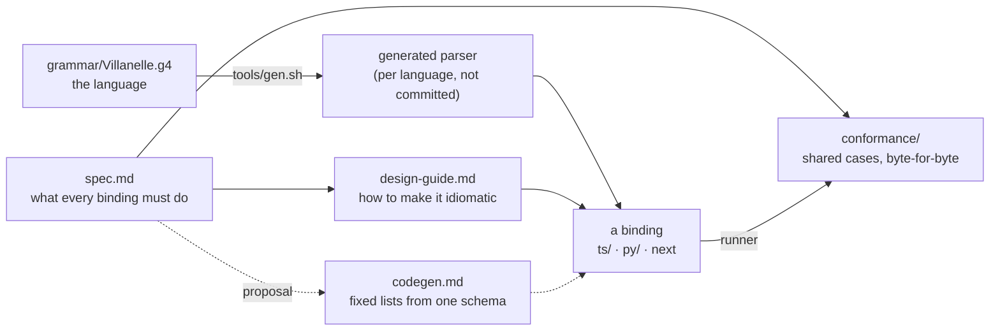

# Language bindings

A **language binding** is villanelle's API in one programming language: a package that parses
villanelle text, loads a config's files, lets a program edit and save them, and builds the rendered
tree a program reads. TypeScript (`ts/`) and Python (`py/`) are the two bindings today.

Each binding exposes the same layers:

| Layer | What a program does with it | Spec |
|---|---|---|
| Syntax | parse one text into tokens and a lossless tree, with syntax diagnostics | [spec.md 3](spec.md#3-syntax-layer) |
| Low level | load the config as written (every file, variable and include), edit it, save it back | [spec.md 6](spec.md#6-low-level-the-config-as-written) |
| Rendered tree | read directives after expansion, with origins, addresses, value readers and change lists | [spec.md 7](spec.md#7-rendered-tree-the-middle-layer) |
| High level | idiomatic sugar per language (bead vil-xlo) | not built; [spec.md 8](spec.md#8-high-level-future) |

The core does no I/O: files come in through a document source and go out through a writer that the
program supplies ([spec.md 4](spec.md#4-ports-where-files-come-from-and-go-to)). Include is an
extension a program turns on ([spec.md 5](spec.md#5-extensions)).

## How the pieces fit

- [spec.md](spec.md): the normative rules, language-neutral. If a binding and the spec disagree,
  the binding has a bug, unless the work proves the spec wrong; then the spec is corrected.
- [design-guide.md](design-guide.md): the owner's goals, the naming and structure rules, what may
  differ per language, the TypeScript and Python concept map, and a checklist for a new binding.
- `conformance/`: the shared cases. A binding proves it meets the spec by producing every expected
  file byte for byte ([spec.md 9](spec.md#9-conformance) lists which case files cover which section).
- [codegen.md](codegen.md): a proposal, awaiting the owner, to generate the fixed lists (codes,
  kinds, records) and a shared conformance driver from one schema.
- The skill `.claude/skills/villanelle-binding/SKILL.md` is the agent's entry point for adding a
  binding or changing the API. It points here.

The reference pages for programs using villanelle are separate:
[low-level-api.md](../low-level-api.md), [rendered-tree.md](../rendered-tree.md) and
[language.md](../language.md).

## Status

These pages describe the API on `feat/low-level-layer` (PR 4). The round 13 review
([review.md](../../.claude/design/consumer-api/round13/review.md)) proposes renames and moves; each
appears in the spec as a "Proposed (pending owner)" note, not as a rule. Nothing is locked until the
owner likes the user APIs (2026-10-27).
