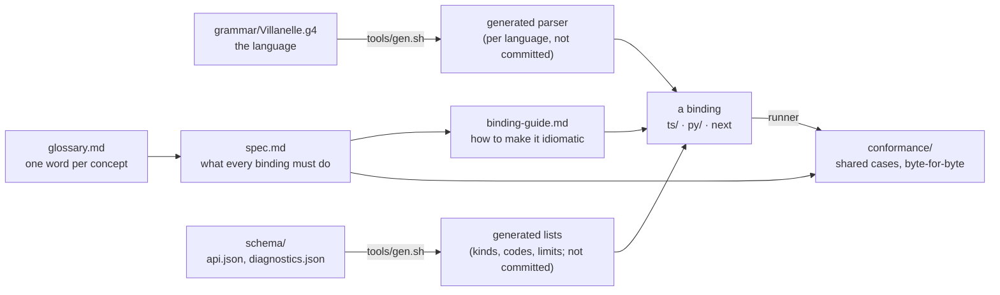

# Language bindings

A **language binding** is villanelle's API in one programming language: a package that parses
villanelle text, loads a config's files, lets a program edit and save them, and builds the rendered
tree a program reads. TypeScript (`ts/`) and Python (`py/`) are the two bindings today.

Each binding exposes the same layers:

| Layer | What a program does with it | Spec |
|---|---|---|
| Syntax | parse one text into tokens and a lossless tree, with syntax diagnostics | [spec.md 3](spec.md#3-syntax-layer) |
| Low level | load the config as written (every file, variable and include), edit it, save it back | [spec.md 6](spec.md#6-low-level-the-config-as-written) |
| Rendered tree | `render(graph)`, then read directives after expansion, with origins, addresses, value readers and change lists | [spec.md 7](spec.md#7-rendered-tree-the-middle-layer) |
| High level | idiomatic sugar per language (bead vil-xlo) | not built; [spec.md 8](spec.md#8-high-level-future) |

The core does no I/O: files come in through a document source and go out through a writer that the
program supplies ([spec.md 4](spec.md#4-ports-where-files-come-from-and-go-to)). Include is an
extension a program turns on ([spec.md 5](spec.md#5-extensions)).

Each layer has its own types and builds only on the layers below it: the low level never imports,
names or returns anything from the rendered tree, and the rendered tree's `render(graph)` takes a
graph (owner, 2026-10-29: "The low level shouldn't "depend on" the middle layer — they should have different domain objects. The middle layer of objects can build on the lower layer domains"; [spec.md 5, "Layer direction"](spec.md#5-extensions)).

## How the pieces fit

This folder is canonical (owner, 2026-10-27: "Within villanelle I want the spec to win over a
reference language"). If a binding and these pages disagree, the binding has a bug, unless the work
proves the spec wrong; then the spec is corrected and the finding reported.

- [spec.md](spec.md): the normative rules, language-neutral.
- [contract.md](contract.md): the contract at the edges, where a value or an error reaches a program: positions in
  each language's string unit, the text a located thing prints as, numbers, error classes, adapters.
- [glossary.md](glossary.md): one word per concept, one meaning per word, and each concept's type
  name in each layer and binding.
- [schema/api.json](schema/api.json): the concepts and their members (property or method), the kind
  lists, error groups, limits, reserved names and name patterns.
  [schema/diagnostics.json](schema/diagnostics.json): every diagnostic code with its name, message,
  owning layer and the operations that find it. Each binding's fixed lists are generated from these
  two files ([codegen.md](codegen.md)).
- [binding-guide.md](binding-guide.md): the owner's goals, the naming and structure rules, what may
  differ per language, the TypeScript and Python concept map, and a checklist for a new binding.
- `conformance/`: the shared cases. A binding proves it meets the spec by producing every expected
  file byte for byte ([spec.md 9](spec.md#9-conformance) lists which case files cover which section).
- [codegen.md](codegen.md): what is generated from the schema, where it goes, and what stays
  hand-written.
- The skill `.claude/skills/villanelle-binding/SKILL.md` is the agent's entry point for adding a
  binding or changing the API. It points here.

The reference pages for programs using villanelle are separate:
[low-level-api.md](../docs/low-level-api.md), [rendered-tree.md](../docs/rendered-tree.md) and
[language.md](../docs/language.md).

## Status

Milestone 1 (bead vil-fy4) settles the round 13 review's root cause 1 (the glossary), root cause 2
(where each operation lives) and the schema half of root cause 5, with the owner's three answers of
2026-10-29 on the round 13 gate page ([review.md](../.claude/design/consumer-api/round13/review.md)):

1. Where `render` lives: first "B graph.render()", then clarified: "The low level shouldn't "depend on" the middle layer — they should have different domain objects. The middle layer of objects can build on the lower layer domains". So `render(graph)` is the rendered layer's
   function, the low level has no render member, and every other operation is a method on the
   object you hold; the processor only loads (spec 6.2, 7.0).
2. The word for values a program passes in: "A overrides" (spec 6.2, 6.3).
3. Values going in: "A Keep text only, make misuse impossible" (spec 6.9), and "Can "set_values"
   become simply "set"?": the edit that replaces values is `set(text)` (spec 6.5).

Milestone 2 (beads vil-0vz, vil-9fy, vil-5ya, vil-gxu) settles root cause 3 (types that carry the kinds: spec
2.10), root cause 4 (the contract at the edges: [contract.md](contract.md)), and the owner's "Yes" of 2026-10-29 to
the rendered layer building only on the low level's public objects (spec 6.10, 7.0). Its exact old-to-new list is
`.claude/design/consumer-api/round14/frozen-m2.md`; the bindings carry the older names until its binding work
lands. The shared corpora and the shared conformance driver are milestone 3; the proposals left stay marked
"Proposed (pending owner)". Nothing is locked until the owner likes the user APIs (2026-10-27).
