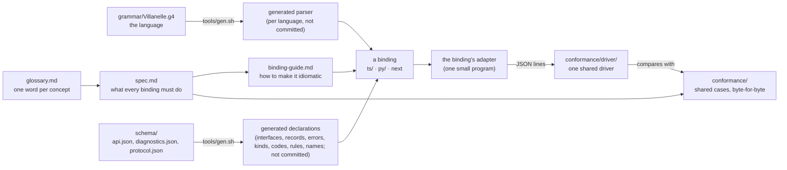

# Language bindings

A **language binding** is villanelle's API in one programming language: a package that parses
villanelle text, loads a config's files, lets a program edit and save them, and builds the rendered
tree a program reads. TypeScript (`ts/`) and Python (`py/`) are the two bindings today.

Each binding exposes the same layers:

| Layer | What a program does with it | Spec |
|---|---|---|
| Syntax | parse one text into tokens and a lossless tree, with syntax diagnostics | [spec.md 3](spec.md#3-syntax-layer) |
| Low level | load the config as written (every file, variable and include), edit it, save it back | [spec.md 6](spec.md#6-low-level-the-config-as-written) |
| Rendered tree | `render(graph)`, then read directives after expansion, with origins, addresses, value readers and change lists | [spec.md 7](spec.md#7-rendered-tree-the-middle-layer) |
| High level | idiomatic sugar per language (bead vil-xlo) | not built; [spec.md 8](spec.md#8-high-level-future) |

The core does no I/O: files come in through a document source and go out through a writer that the
program supplies ([spec.md 4](spec.md#4-ports-where-files-come-from-and-go-to)). Include is an
extension a program turns on ([spec.md 5](spec.md#5-extensions)).

Each layer has its own types and builds only on the layers below it: the low level never imports,
names or returns anything from the rendered tree, and the rendered tree's `render(graph)` takes a
graph (owner, 2026-10-29: "The low level shouldn't "depend on" the middle layer — they should have different domain objects. The middle layer of objects can build on the lower layer domains"; [spec.md 5, "Layer direction"](spec.md#5-extensions)).

## How the pieces fit

This folder is canonical (owner, 2026-10-27: "Within villanelle I want the spec to win over a
reference language"). If a binding and these pages disagree, the binding has a bug, unless the work
proves the spec wrong; then the spec is corrected and the finding reported.

- [spec.md](spec.md): the normative rules, language-neutral.
- [expansion.md](expansion.md): the normative scoping and precedence rules: which definition a `$name` or a `use`
  reaches, what an included file sees, what an override reaches, and the one precedence table.
- [contract.md](contract.md): the contract at the edges, where a value or an error reaches a program: positions in
  each language's string unit, the text a located thing prints as, numbers, error classes, adapters.
- [glossary.md](glossary.md): one word per concept, one meaning per word, and each concept's type
  name in each layer and binding.
- [schema/api.json](schema/api.json): every concept with its typed members (in the closed type grammar of
  codegen.md section 2), the kind lists, keywords, error groups, limits, reserved names, name patterns and free
  functions. [schema/diagnostics.json](schema/diagnostics.json): every diagnostic code with its name, message,
  owning layer and the operations that find it. [schema/protocol.json](schema/protocol.json): the adapter
  protocol's messages. [schema/api.schema.json](schema/api.schema.json): the JSON Schema the three match. Each
  binding's declarations, and the adapter's message types, are generated from them ([codegen.md](codegen.md)).
- [binding-guide.md](binding-guide.md): the owner's goals, the naming and structure rules, what may
  differ per language, the TypeScript and Python concept map, and a checklist for a new binding.
- [conformance.md](conformance.md): the conformance levels (below), the adapter protocol a binding implements, and the
  shared driver that runs every case against it.
- `conformance/`: the shared cases and the driver. A binding proves it meets the spec when the driver, run against its
  adapter, finds every output equal to its expected one byte for byte ([spec.md 9](spec.md#9-conformance) lists
  which corpus covers which section).
- [codegen.md](codegen.md): what is generated from the schema, where it goes, and what stays
  hand-written.
- The skill `.claude/skills/villanelle-binding/SKILL.md` is the agent's entry point for adding a
  binding or changing the API. It points here.

The reference pages for programs using villanelle are separate:
[low-level-api.md](../docs/low-level-api.md), [rendered-tree.md](../docs/rendered-tree.md) and
[language.md](../docs/language.md).

## Conformance levels

A binding claims one level; it holds it when every shared case at that level and below passes
([conformance.md 2](conformance.md#2-conformance-levels)).

| Level | What |
|---|---|
| L0 | syntax: tokens, the lossless tree, syntax diagnostics |
| L1 | the low level: load, edit, save |
| L2 | the rendered tree: render, readers, addresses, diff, and the contract at the edges |
| L3 | extensions: include |
| L4 | adapters: memory writer, file and fetch (no shared cases yet) |

## A new binding's path

1. **Generate**: add the language to `tools/gen.sh` (the parser; ANTLR 4.13.2 has no official Rust target, an open
   question in [binding-guide.md 5](binding-guide.md#5-checklist-a-new-binding-start-to-finish)) and
   `tools/gen-api.py` (the fixed lists). The adapter of step 2 can come first, with a stub `parse`.
2. **Write the adapter**: one small program that answers the driver's requests through the binding's public API
   ([conformance.md 6](conformance.md#6-what-a-binding-writes)). It starts by answering `hello` and `parse`.
3. **Run the driver**: `python3 conformance/driver/run.py -- <your adapter's command>`.
4. **Climb the levels**: claim L0, then build each layer and raise the claim as its cases pass, to L3.

[binding-guide.md 5](binding-guide.md#5-checklist-a-new-binding-start-to-finish) is the full checklist.

## Status

Milestone 1 (bead vil-fy4) settles the round 13 review's root cause 1 (the glossary), root cause 2
(where each operation lives) and the schema half of root cause 5, with the owner's three answers of
2026-10-29 on the round 13 gate page ([review.md](../.claude/design/consumer-api/round13/review.md)):

1. Where `render` lives: first "B graph.render()", then clarified: "The low level shouldn't "depend on" the middle layer — they should have different domain objects. The middle layer of objects can build on the lower layer domains". So `render(graph)` is the rendered layer's
   function, the low level has no render member, and every other operation is a method on the
   object you hold; the processor only loads (spec 6.2, 7.0).
2. The word for values a program passes in: "A overrides" (spec 6.2, 6.3).
3. Values going in: "A Keep text only, make misuse impossible" (spec 6.9), and "Can "set_values"
   become simply "set"?": the edit that replaces values is `set(text)` (spec 6.5).

Milestone 2 (beads vil-0vz, vil-9fy, vil-5ya, vil-gxu) settles root cause 3 (types that carry the kinds: spec
2.10), root cause 4 (the contract at the edges: [contract.md](contract.md)), and the owner's "Yes" of 2026-10-29 to
the rendered layer building only on the low level's public objects (spec 6.10, 7.0). Its exact old-to-new list is
`.claude/design/consumer-api/round14/frozen-m2.md`; the bindings carry the older names until its binding work
lands.

Milestone 3 (beads vil-j80, vil-033) settles the rest of root cause 5: one shared driver and an adapter per binding
([conformance.md](conformance.md)), the key rule as data, new corpora for rendered addresses, diff order, the
readers and `format diagnostic`, and the comment in a values text (spec 2.8). Its exact list is
`.claude/design/consumer-api/round14/frozen-m3.md`.

Milestone 4 (beads vil-umh.1 to vil-umh.8 and vil-umh.12) carries out the round 15 review's next steps
(`.claude/design/consumer-api/round15/review.md`) with the owner's answers of 2026-10-29: Q1, "';' is required and a
line break is plain whitespace (nginx); directive names cannot start with a digit or '-'" (the grammar); Q2, "Keep
today's model and write it down in the spec" ([expansion.md](expansion.md)). It also moves the text-only rules into
the grammar as entry rules (spec 2.8), shows an unread include copy (6.10), adds the lost update error (4.2),
rebuilds the error classes on the two sorts (2.8, contract 4), makes the low level the one owner of expansion (2.9,
6.10, 7), and fixes three Python defects (2.9, 4.1, 5). Its exact list is
`.claude/design/consumer-api/round15/frozen-m4.md`.

Milestone 5 (beads vil-umh.6, vil-umh.12 and vil-umh.14) applies the owner's answers of 2026-10-29 on the smaller
language fixes, each put to him in plain words: single quotes are raw strings ("yes"); the `plain` reader is deleted
("agreed. the raw strings are raw/plain/tokens until some schema-aware layer decides "this one is a number" or "this
is a string""); the slice separator leaves the word alphabet, so `:` is a word character again, and a variable may be
subscripted ("yes"; `~`, since `..` cannot lex next to number-like words: spec 3.1); the language statements go
behind one sigil, `@set`, `@snippet`, `@use`, `@include`, so no directive name is reserved ("yes"). It adds a
written value's `set`, which keeps its handle ("the natural loop should work", spec 6.1), and config text as its own
type ("Yes, its own type", spec 6.9), and settles three milestone 4 leftovers (spec 2.8's reworded entry-rule rule,
a `set` text with no value, `render` given a non-graph). Its exact list is
`.claude/design/consumer-api/round15/frozen-m5.md`.

Milestone 6 (beads vil-umh.9, vil-umh.10, vil-umh.11 and vil-umh.13) applies the owner's answers of 2026-10-29 on Q3
("Yes, with idiom expressed as typed per-language traits; start after the scoping and layer decisions"), on
enumerations ("Yes, generate both") and on namespaces ("Yes, rename now"): the schema is typed and is the source of
every public signature, generated per language by one loader and one emitter each ([codegen.md](codegen.md)); kind
lists are real enumerations in both bindings, compared by member inside them (spec 2.10); each layer is its own
import path, type names have no prefix, and every layer's block has one shape (binding guide rules 2, 5 and 9, spec
2.11). Its exact list is `.claude/design/consumer-api/round15/frozen-m6.md`. The proposals left stay marked "Proposed (pending owner)". Nothing is locked until the owner likes the user
APIs (2026-10-27).
